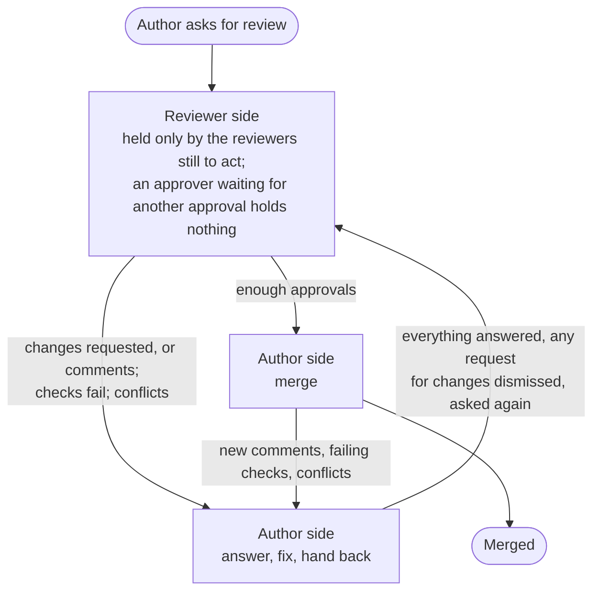
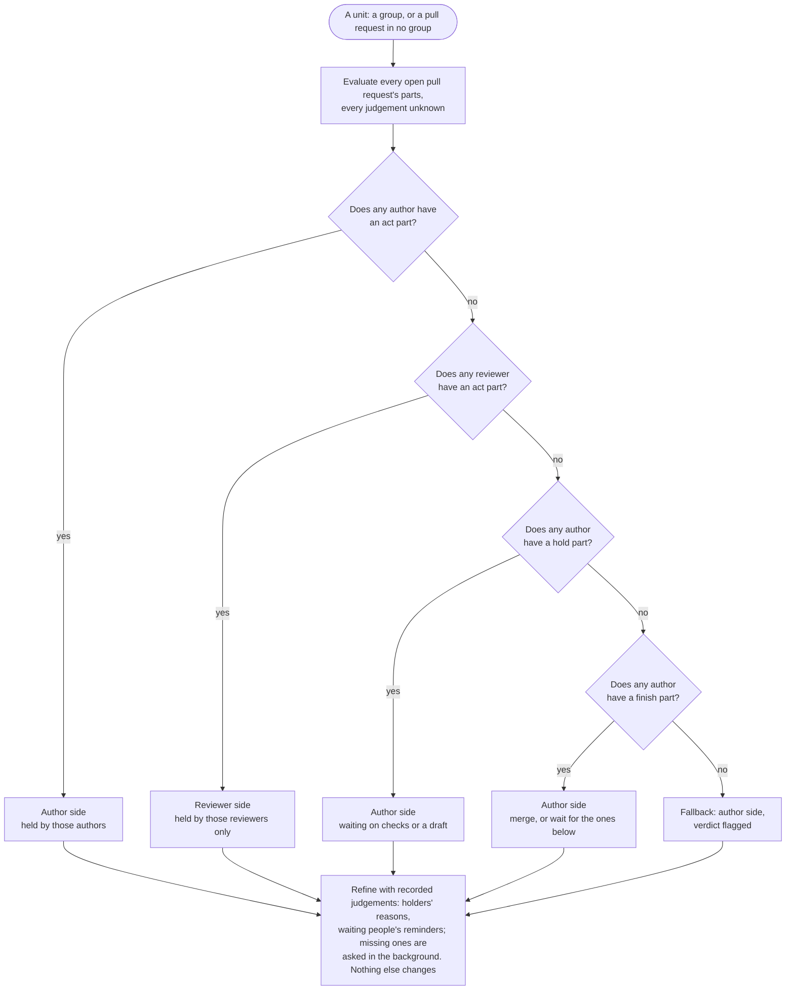

# 4. Verdicts

Every unit of work has one ball. A **unit** is a group, or a pull request in no group. At any moment its ball is on exactly one side — the author side or the reviewer side — held by the people on that side who must act next. Park's conclusion for a unit — where its ball is, who holds it, what each holder should do, and why — is the unit's **verdict**.

A review, as the ball sees it:

## Responsibilities

- Work out each person's role on each pull request.
- Evaluate the published rules for each person's part.
- Place each unit's ball from those parts, the same way every time.
- Store each new verdict with everything needed to explain it, and hand changes to tasks and to the dashboard.

## Data

| Record | Holds |
|---|---|
| `verdict` | One conclusion for one unit (below); current, or superseded by a newer one |
| `judgement` | A model's answer: question, fingerprint, answer, confidence, reason, provider kind, model name, time taken, time. Failed calls are recorded as failed attempts, not answers |
| `member_action` | Actions of members that rules can read — so far, marking a pull request as nudged |

## Roles

A role is a function of (person, pull request), computed from facts — not a column on the member. People here are forge accounts, members of Park or not, so an outside reviewer can hold a ball too.

| Role | The person holds it when |
|---|---|
| Author | Their account opened the pull request |
| Reviewer | They are not the author, and a review is requested from them — directly, or through a team they belong to — or they have submitted a review |

A person holds at most one role on a pull request. People with neither role have no part in it. A request to a team counts only if the team has at least one member other than the author; a team whose members Park cannot resolve, or whose only member is the author, is as good as no request. A request through a team asks for a first review; handing a pull request back to a reviewer takes a request to them directly.

## Parts

Only open pull requests take part: a merged or closed pull request stays in its group, but has no parts. For each open pull request of a unit, Park evaluates the author list for its author, and the reviewer list for each of its reviewers ([Rules](05-rules.md)). Each evaluation gives that person's **part** on that pull request: a kind, and with it an action, targets, priority, reason, and possibly a reminder.

| Kind | Means |
|---|---|
| `act` | This person has something to do |
| `hold` | The ball is this person's, but they wait on something that is not a person: their own draft, running checks. Authors only. It never outranks someone else's work |
| `finish` | Only the last step is left: merging, or waiting for the pull requests below to merge. Authors only |
| `idle` | Nothing for this person now |

A part says what one person has to do. It never says who else must act: that follows from placing the ball.

## Placing the ball

Once per unit, from every part in it:

1. **The author side**, if any author has an `act` part. The work is the author's until it is handed back as a whole.
2. Otherwise, **the reviewer side**, if any reviewer has an `act` part.
3. Otherwise, **the author side**, if any author has a `hold` part: the author only waits, on running checks or on their own draft.
4. Otherwise, **the author side**, if any author has a `finish` part: only merging, or waiting for the pull requests below, is left.
5. Otherwise, **the fallback**: the author side, held by the authors of the unit's open pull requests, with the verdict flagged, because the rules found nothing for anyone to do. The default rule set never needs it.

The **holders** are the people on that side whose parts placed the ball, and their parts are their actions, pull request by pull request. Being on the holding side is not holding the ball: a reviewer who has approved, or has nothing to do, holds nothing, even while the ball is on the reviewer side. Parts on the other side are recorded, but hold nothing either: a reviewer's first review of `web#7` waits while the author still has work on `api#12`. Waiting is different: an author who only waits — on running checks, or on a draft kept back until another pull request merges — does not hold back anyone's review.

Placement treats every judgement as unknown, so it never waits on the model, and no model answer can move a ball.

| State of a unit | Its ball |
|---|---|
| Ana fixes failing checks on `api#12`; `web#7` waits for Ben's first review | Author side: Ana |
| `api#12` waits for Ben's first review; `web#7` stays a draft until `api#12` merges | Reviewer side: Ben |
| Ana's `api#12` waits for Ben's first review; Carol's `web#7` has checks running | Reviewer side: Ben |
| `api#12` asks Ben and Carol for a first review | Reviewer side: Ben and Carol |
| Two approvals required: Ben approved; Carol has not reviewed yet | Reviewer side: Carol only. Ben's approval is his last word; he waits too |
| Ben approved, and Ana asks him to review again | Reviewer side: Ben, because the author asked him |
| `api#12` by Ana and `web#7` by Carol both have comments to answer | Author side: Ana and Carol |
| Ben approved both | Author side: Ana, to merge |

## What a verdict holds

| Field | Meaning |
|---|---|
| Unit | The group, or the pull request |
| Side | `author` or `reviewer` |
| Holders | The people holding the ball, each with their actions, targets, priorities, and reasons, pull request by pull request |
| Since | For each holder, when they started holding it |
| Parts | Every person's part on every pull request, with its path through the rules: each rule tried, and its outcome — matched, not matched, unknown judgement, or error |
| Reminders | Reminders offered to people waiting on the holders |
| Fallback | Whether placement needed the fallback |
| Judgements | The judgements used, with their answers and confidence |
| Inputs | The value of every field for every person, the evaluation time, and the fact sequence numbers they were computed from |
| Rule set | The published version that produced it |

## Actions

| Action | Role | Meaning | Can be a task |
|---|---|---|---|
| `resolve_conflicts` | Author | Make the pull request mergeable again | Yes |
| `fix_checks` | Author | Make the failing required checks pass | Yes |
| `address_comments` | Author | Answer or resolve the review threads, and answer the written reviews, that wait on you | Yes |
| `request_review` | Author | Hand the pull request back — dismiss a standing request for changes, saying what changed, and ask again; or, when you may not dismiss, just ask again — or ask for a first review | Yes |
| `review` | Reviewer | Review the pull request, for the first time or again | Yes |
| `unblock` | Author | Do what the forge still requires before merging: bring the branch up to date, resolve conversations, and the like | No |
| `merge` | Author | Everything is in place; merge it | No — only people merge |

What makes each task-capable action done is defined in [Tasks](06-tasks.md).

A **reminder** is not an action. A part can offer one to a person who is waiting on the holders: nudge them. The member marks it done on the dashboard, and the mark is a member action that rules can read. A reminder never moves the ball.

## Flow: evaluate a unit

Runs when, for this unit: the facts of any of its pull requests change; its membership changes; a judgement about it is recorded; a member acts on it, such as marking it nudged; a new rule set is published; or an account link or team membership changes someone's role — in the first release, with the next hourly pass ([D55](10-design-log.md#d55-links-and-team-changes-wait-for-the-hourly-pass)). An hourly pass also re-evaluates every open unit, because rules can read elapsed time. When a pull request moves between groups, both units are evaluated.

Evaluations of one unit are serialized: each takes the unit's lock, so two pull requests of a group changing at once cannot evaluate the unit side by side.

1. **Load** the unit's open pull requests with their facts and chains, and fix the evaluation time.
2. **Find each pull request's people** and their roles.
3. **Build each person's input**: the fields of the [field catalog](05-rules.md#the-field-catalog), computed from the facts for that person.
4. **Evaluate each person's list** with every judgement unknown. For each rule:
   1. If the condition is true, the rule matches. If it is false, go to the next rule.
   2. A condition that depends on a judgement does not match now; the path records it as "unknown judgement".
   3. A condition that fails at run time, or exceeds its cost limit, does not match. The error is recorded in the path, and the rule is flagged on the dashboard.
5. **Place the ball** (above).
6. **Refine.** For each holder, and for each waiting person whose path passed over a reminder rule on an unknown judgement, look those judgements up, and evaluate that person's list again with the ones that are recorded. A refined part is kept only if nothing but its reason or reminder changed; otherwise the part from step 4 stands, and the rule is flagged. A judgement not recorded yet does not hold anything up: it is asked in the background (next flow), and when its answer is recorded, the unit is evaluated again.
7. **Compare** with the unit's current verdict. If the side, the holders with their actions and reasons, the reminders, every part, and what the board reads of each person's inputs — their review, whether one is asked of them directly, and the threads waiting on them — are all unchanged, store nothing. An evaluation that changes only inputs nobody is shown, such as the hours since a request, stores nothing ([D70](10-design-log.md#d70-a-change-that-moves-no-ball-is-stored-when-it-is-shown)).
8. **Otherwise store** a new verdict and make it current, and queue work for tasks and the dashboard. A verdict records the fact sequence number it read of each pull request, and never replaces one computed from newer facts of any of them ([D54](10-design-log.md#d54-fact-sequence-numbers-are-kept-pull-request-by-pull-request)).

When every pull request of a unit is merged or closed, its verdict is closed out, with the reason "Merged" when every one of them merged, or "Closed". A unit that was never evaluated while open gets no verdict, and a unit left with no pull requests — a group merged into another — has none.

## Model judgement

Some questions have no reliable structural answer. Rules name them as **judgements**; the model answers them, and Park records each answer as a fact. Judgements only sharpen what a holder is told, or decide whether someone waiting is offered a reminder.

### Questions

| Question | Asked for | Asks | Used to | Why a rule cannot decide |
|---|---|---|---|---|
| `commits_address_my_comments` | Reviewer | Do the commits pushed since my latest review respond to my unresolved comments? | Tell a reviewer who is asked again where to look | Outdated markers mislead both ways: the author may touch my lines while fixing someone else's comment, or fix my concern in a caller |
| `comments_blocking` | Reviewer | Does any of my unresolved comments raise a real problem, rather than a matter of taste? | Decide whether a waiting reviewer is offered a reminder | A count cannot tell a naming nit from a concurrency bug |

Each question defines, in code, what it reads, the prompt it sends, and its answers — `yes` or `no` — each returned with a confidence between 0 and 1 and a one-sentence reason.

A question's **fingerprint** is a hash of the question and its version, the person it is asked for, and the identity of everything it reads: comment IDs with their last edit times, and commit IDs. Anything that could change the answer changes the fingerprint.

### Flow: get a judgement

Judgements are asked in the background; nothing waits for them.

1. **Compute the fingerprint.**
2. **If an answer is recorded** for it, use it. No model call.
3. **If no model provider is configured**, the judgement is unknown, and nothing is asked.
4. **If the same fingerprint is already queued or being asked**, do nothing more: that call's answer will serve.
5. **Ask.** A background worker takes a slot under the concurrency limit, fetches the texts the question reads from the forge, sends the question, and waits up to the timeout.
6. **Validate** the answer against the question's schema. An invalid answer counts as an error.
7. **Record** the judgement, and evaluate the unit again, so the reason or reminder it sharpens appears. A question and fingerprint have one judgement: if two servers ask at once, the first answer recorded stands, and the other is discarded.
8. **Below the question's confidence threshold**, the recorded answer counts as unknown. The path shows it — "asked again · model unsure (0.55)" — so a reader can tell the reason came from the rules, not from the model.
9. **On a timeout or an error**, the judgement stays unknown, and the question is retried after a backoff.

### What this gives

- **No model answer moves a ball.** Placement ignores judgements, and a refinement changes nothing but a reason or a reminder; in grouping, the model only suggests ([Grouping](03-grouping.md)). With no provider, every ball is where it would be with one; reasons are plainer, and no reminder depends on a judgement.
- **Nothing waits on the model.** A verdict is stored at once, with the reasons the rules give; a reason may sharpen a moment later, when an answer arrives. The ball, the actions, and the tasks never change with it.
- **Reproducible.** Replaying a verdict reads the recorded judgements and never calls the model again. Rule logic is tested with recorded judgements, without network mocks.
- **Bounded cost.** Questions are asked only for holders and possible reminders, once per distinct input.
- **Visible provenance.** Every verdict lists the judgements it used, so the dashboard shows which reasons came from a model, and with what confidence.

The cost: a reason can change shortly after it is first shown; and concurrency is capped, so a burst of new questions waits its turn rather than crowding out other work.

### What is sent

Before a model provider is enabled, the settings page lists each question and what it sends. Verdict questions send only the review threads and commits of the pull request they are about; grouping questions send titles, branch names, and references ([Grouping](03-grouping.md)). Nothing sent includes credentials.

## Rules

- **V1. Verdicts are pure functions** of their inputs, rule set version, and recorded judgements. Replaying one gives the same conclusion.
- **V2. One ball per unit**, on exactly one side, with at least one holder. There is no other record of whose turn it is.
- **V3. Precedence places the ball**: author work, then reviewer work, then an author who only waits, then the author's last step, then the fallback.
- **V4. Parts are per person per open pull request**, from at most one role; the author role takes precedence. No role, no part; a merged or closed pull request has no parts.
- **V5. No model answer moves a ball.** Placement treats every judgement as unknown; a refinement may change a part's reason or reminder, and nothing else; judgements are asked in the background, and nothing waits for them.
- **V6. Unknown never matches.** A condition that depends on an unknown judgement — no provider, a timeout, an error, or low confidence — does not match.
- **V7. Tasks are not an input.** Verdicts read facts only. While an executor works, the ball stays where the facts put it, and the task's state is shown beside it.
- **V8. Verdicts are immutable.** A new one is stored only when something a person sees changes: the ball, what anyone has to do and why, the reminders, or what the board reads of a person's inputs (step 7).
- **V9. Every verdict explains itself**, with every part's path, its judgements, its inputs, and its rule set version.
- **V10. Queues are derived.** A member's queue is the units whose ball they hold; their waiting list is the units they have a part in, where the ball is with someone else. Their `act` parts in a unit on their waiting list are shown to them as their work all the same, and move no ball ([D73](10-design-log.md#d73-work-where-someone-else-holds-the-ball-is-shown-too)).

## Defaults

| Setting | Default |
|---|---|
| Model call timeout | 20 seconds |
| Concurrent model calls | 4 |
| Confidence threshold | 0.7, per question |
| Re-evaluation for elapsed time | Hourly |
| Retry after a model error | 1 minute, doubling up to 1 hour |
