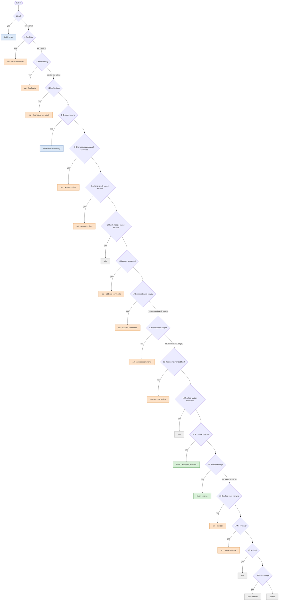
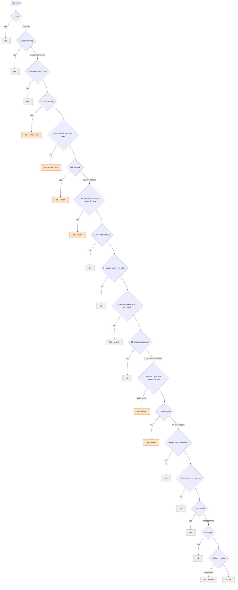

# 5. Rules

Rules turn facts into verdicts. They live in the database, are drawn and edited on the dashboard, and are versioned. A rule list describes one person's part on one pull request: whether they have something to do, and what. Where the ball goes is not up to any one list; it is placed once per unit, from everyone's parts ([Verdicts](04-verdicts.md#placing-the-ball)). This chapter covers what a rule is, what it can read, the rules Park ships with, and how rules change.

## A rule

| Part | Meaning |
|---|---|
| Role | `author` or `reviewer`. Each role has its own ordered list, evaluated for every person who holds that role on a pull request |
| Position | Its place in that list |
| Name | Shown in a verdict's path when the rule matches: "Checks failing" |
| Passed-over label | Optional; shown in the path when the rule does not match: "checks not failing" |
| Condition | Structured, or an expression (below) |
| Conclusion | Kind, action, targets, priority, reason, whether it reminds, and whether it may become a task (below) |

The first rule in the list whose condition matches decides that person's part; later rules are not evaluated. A person's path therefore reads like a walk down a tree:

```
author → not a draft → no conflicts → checks not failing → Changes requested, all answered
```

A rule with no passed-over label leaves no trace when it does not match. Rules the evaluation never reached do not appear at all: a step missing from the path was not checked — it did not pass.

## Conditions

Two forms, evaluated by one engine:

- **Structured** (the default): `(field, operator, value)` terms joined by AND and OR, edited with drop-downs.
- **Expression**: a CEL (Common Expression Language) expression over the same fields, for conditions the structured form cannot state.

Structured conditions compile to CEL, so there is one evaluator, one test harness, and one audit trail; the structured editor is a view over a subset of the language. The dashboard marks expression rules wherever rules are listed, so they stay exceptions.

| Field type | Structured operators |
|---|---|
| Boolean | is true, is false |
| Number | =, ≠, <, ≤, >, ≥ |
| Choice | is, is not, is one of |
| Text | is, is not, starts with, contains |
| List | is empty, is not empty, contains |
| Optional | is set, is not set, and the operators of its type. A comparison is false when the field is not set |
| Judgement | is `yes`, is `no` |

A structured condition and what it compiles to:

```
me.threads_on_me  >  0         AND   pr.blocked_by  is not empty
me.threads_on_me > 0 && size(pr.blocked_by) > 0
```

A condition only an expression can state — every failing required check is an end-to-end test:

```
pr.checks == 'failing' && pr.failing_checks.all(c, c.startsWith('e2e-'))
```

## The field catalog

Everything a condition can read. Fields are computed for one person on one pull request. A reviewer's **decisive review** is their latest review that approves or requests changes; reviews that only comment do not change it.

**Pull request**

| Field | Type | Meaning |
|---|---|---|
| `pr.repo` | text | Repository name |
| `pr.title` | text | Title |
| `pr.labels` | list of text | Labels |
| `pr.base` | text | Base branch |
| `pr.author` | account | The author |
| `pr.draft` | boolean | The pull request is a draft |
| `pr.conflicting` | boolean | The forge reports conflicts with the base branch |
| `pr.checks` | choice | The required checks on the head commit: `failing` if any failed; else `pending` if any is still running or has not reported on this head yet; else `passing` if there are any; else `none` |
| `pr.failing_checks` | list of text | Names of the failing required checks |
| `pr.hours_checks_pending` | optional number | Hours since the required checks on the head commit started pending |
| `pr.approvals` | number | Reviewers whose decisive review approves, is not dismissed, and counts toward the forge's requirement — for example, because they have write access |
| `pr.required_approvals` | number | The larger of the forge's requirement for the base branch and the team's minimum, 1 by default |
| `pr.blocked_by` | list of accounts | Reviewers whose decisive review requests changes and is not dismissed |
| `pr.blockers_rerequested` | boolean | Everyone in `pr.blocked_by` has a pending direct review request |
| `pr.requested` | list of accounts and teams | Pending review requests: accounts, and teams with at least one member other than the author |
| `pr.hours_requested` | optional number | Hours since the oldest pending review request |
| `pr.reviewed` | boolean | Someone other than the author has submitted a review |
| `pr.unanswered_reviews` | number | Reviews with a written body that request changes or only comment, after which the author has neither commented on the pull request nor pushed |
| `pr.threads_on_reviewers` | number | Unresolved threads whose latest comment is the author's, and whose other participants include someone who has not approved |
| `pr.awaited_reviewers` | list of accounts | Those participants: the ones who have not approved |
| `pr.awaited_rerequested` | boolean | Everyone in `pr.awaited_reviewers` has a pending direct review request |
| `pr.mergeable_now` | boolean | The forge says the pull request can be merged now |
| `pr.merge_blocked_by` | list of choices | What the forge says blocks merging: `reviews`, `code_owners`, `checks`, `behind`, `conflicts`, or `other` |
| `pr.code_owners_pending` | list of accounts and teams | Code owners whose approval the forge still requires |
| `pr.author_can_dismiss` | boolean | The author is allowed to dismiss reviews in this repository |

**The member**

| Field | Type | Meaning |
|---|---|---|
| `me.role` | choice | `author` or `reviewer` |
| `me.threads_on_me` | number | Unresolved threads waiting on me. For the author: those whose latest comment is not the author's. For a reviewer: those I started or commented in whose latest comment is the author's |
| `me.threads_open` | number | Unresolved threads I started |
| `me.requested` | boolean | A review is requested from me directly, not only through a team |
| `me.code_owner` | boolean | The forge requires my approval as a code owner |
| `me.reviewed` | boolean | I have submitted a review |
| `me.decision` | choice | My decisive review: `approved`, `changes_requested`, or `none` if there is none or it was dismissed |
| `me.reviewed_since_decision` | boolean | I have submitted another review, such as a comment, since my decisive review |
| `me.new_commits` | boolean | The head commit differs from the one my latest review was on |
| `me.hours_since_review` | optional number | Hours since my latest review |
| `me.hours_since_nudge` | optional number | Hours since I last marked this pull request as nudged |

**Chain and group**

| Field | Type | Meaning |
|---|---|---|
| `chain.position` | number | 1 for a pull request that stacks on no open pull request |
| `chain.length` | number | Open pull requests in its chain; 1 when it is not stacked |
| `chain.open_below` | number | Open pull requests it stacks on, directly or not |
| `group.size` | number | Open pull requests in its group; 0 when it has none |

**Judgements** — see [Verdicts](04-verdicts.md#questions)

| Field | Type |
|---|---|
| `judgement.commits_address_my_comments` | judgement |
| `judgement.comments_blocking` | judgement |

No field exposes the forge's own summary review decision. It stays at "changes requested" after the author has answered everything but not yet asked for another review, and goes back to "review required" on every push, pulling reviewers who already reviewed back in. The fields above are built from individual reviews and threads, which do not drift that way. The forge's own merge verdict is exposed (`pr.mergeable_now`, `pr.merge_blocked_by`), but only to decide whether a pull request can be merged, never whose turn it is.

No field exposes where a fact came from, a task's state, another person's part, or where the ball is.

## Conclusions

| Part | Values |
|---|---|
| Kind | `act`: this person has something to do. `hold`: the ball is this person's, but they wait on something that is not a person — their own draft, running checks. `finish`: only the last step is left — merging, or waiting for the pull requests below to merge. `idle`: nothing for this person now. Reviewers conclude only `act` or `idle` |
| Action | Required for `act`, and `merge` for a `finish` that can merge: an action allowed for the role ([Verdicts](04-verdicts.md#actions)) |
| Targets | For `request_review`: an account-list field naming the reviewers to hand the pull request back to, such as `pr.blocked_by`. Without one, anyone will do |
| Priority | `normal` (the default) or `low` |
| Reason | A template, with expressions in braces: `{me.threads_on_me} comments wait on you` |
| Remind | Only for `idle`: remind the people who hold the ball — a nudge. A reminder never moves the ball |
| May become a task | Only for actions that can be tasks. Whether a task is actually created also depends on the member's automation settings ([Tasks](06-tasks.md)) |

A conclusion says nothing about who else must act: that follows from placing the ball.

## The default rule set

Park ships with the rule set below, ported from its predecessor's decision tree, where it ran on a real team's pull requests, and reshaped so that each row states one person's part. Every rule whose action can be a task is marked as able to become one, unless its action says otherwise. The numbers in it — 2 hours, 24 hours, 48 hours, position 3 — are ordinary values, edited like anything else.

In the trees below, each diamond is a rule, tried from the top. An edge labelled with a passed-over label shows what the path says when the rule does not match. Conclusions are coloured by kind: orange `act`, blue `hold`, green `finish`, grey `idle`.

### Author



| # | Rule | When | Kind | Action | Reason |
|---|---|---|---|---|---|
| 1 | Draft | `pr.draft` | hold |  | Draft |
| 2 | Conflicts | `pr.conflicting` | act | `resolve_conflicts` | Conflicts with the base branch |
| 3 | Checks failing | `pr.checks` is `failing` | act | `fix_checks` | {size(pr.failing_checks)} required checks failing |
| 4 | Checks stuck | `pr.checks` is `pending` and `pr.hours_checks_pending` ≥ 2 | act | `fix_checks`, not a task | Required checks have been running for {pr.hours_checks_pending} hours |
| 5 | Checks running | `pr.checks` is `pending` | hold |  | Waiting for checks |
| 6 | Changes requested, all answered | `pr.blocked_by` is not empty, `me.threads_on_me` = 0, `pr.unanswered_reviews` = 0, and `pr.author_can_dismiss` | act | `request_review` to `pr.blocked_by` | Every comment is answered; dismiss {pr.blocked_by}'s request for changes, saying what changed, and ask again |
| 7 | All answered, cannot dismiss | `pr.blocked_by` is not empty, `me.threads_on_me` = 0, `pr.unanswered_reviews` = 0, and not `pr.blockers_rerequested` | act | `request_review` to `pr.blocked_by` | Every comment is answered; you cannot dismiss {pr.blocked_by}'s request for changes, so ask them to review again |
| 8 | Handed back, cannot dismiss | `pr.blocked_by` is not empty, `me.threads_on_me` = 0, and `pr.unanswered_reviews` = 0 | idle |  | Asked {pr.blocked_by} to review again |
| 9 | Changes requested | `pr.blocked_by` is not empty | act | `address_comments` | {pr.blocked_by} requested changes; {me.threads_on_me + pr.unanswered_reviews} items wait on you |
| 10 | Comments wait on you | `me.threads_on_me` > 0 | act | `address_comments` | {me.threads_on_me} comments wait on you |
| 11 | Reviews wait on you | `pr.unanswered_reviews` > 0 | act | `address_comments` | {pr.unanswered_reviews} reviews wait for your answer |
| 12 | Replies not handed back | `pr.threads_on_reviewers` > 0 and not `pr.awaited_rerequested` | act | `request_review` to `pr.awaited_reviewers` | {pr.threads_on_reviewers} of your replies wait on {pr.awaited_reviewers}; finish what you promised, then ask them to look again |
| 13 | Replies wait on reviewers | `pr.threads_on_reviewers` > 0 | idle |  | {pr.threads_on_reviewers} replies wait for the reviewers |
| 14 | Approved, stacked | `pr.approvals` ≥ `pr.required_approvals`, `pr.blocked_by` is empty, and `chain.open_below` > 0 | finish |  | Approved; {chain.open_below} pull requests below it must merge first |
| 15 | Ready to merge | `pr.approvals` ≥ `pr.required_approvals`, `pr.blocked_by` is empty, and `pr.mergeable_now` | finish | `merge` | Approved and passing; ready to merge |
| 16 | Blocked from merging | `pr.approvals` ≥ `pr.required_approvals`, `pr.blocked_by` is empty, and `pr.code_owners_pending` is empty | act | `unblock` | Approved, but the forge still blocks merging: {pr.merge_blocked_by} |
| 17 | No reviewer | `pr.requested` is empty | act | `request_review` | Nobody is asked to review |
| 18 | Nudged | `pr.hours_requested` ≥ 24 and `me.hours_since_nudge` < 48 | idle |  | Nudged; waiting for review |
| 19 | Time to nudge | `pr.hours_requested` ≥ 24 | idle, remind |  | No review since the request; remind the reviewers |
| 20 | Waiting for review | always | idle |  | Waiting for review |

Passed-over labels: 1 "not a draft", 2 "no conflicts", 3 "checks not failing", 10 "no comments wait on you", 11 "no reviews wait on you", 15 "not ready to merge".

### Reviewer



| # | Rule | When | Kind | Action | Reason |
|---|---|---|---|---|---|
| 1 | Draft | `pr.draft` | idle |  | Draft |
| 2 | Checks running | `pr.checks` is `pending` | idle |  | Checks are still running |
| 3 | Approved without you | not `me.reviewed`, not `me.code_owner`, and `pr.approvals` ≥ `pr.required_approvals` | idle |  | Already has the approvals it needs; your review is optional |
| 4 | Team request | not `me.reviewed` and not `me.requested` | act, low | `review` | Requested from your team |
| 5 | First review, deep in a chain | not `me.reviewed` and `chain.position` ≥ 3 | act, low | `review` | First review; {chain.position} of {chain.length} in its chain, not urgent |
| 6 | First review | not `me.reviewed` | act | `review` | First review |
| 7 | Asked again, the author cannot dismiss | `me.decision` is `changes_requested`, `me.requested`, and not `pr.author_can_dismiss` | act | `review` | The author cannot dismiss your request for changes and asked you to review again; lift it if you are satisfied |
| 8 | Your block is stale | `me.decision` is `changes_requested`, `me.reviewed_since_decision`, and `me.threads_open` = 0 | idle |  | You reviewed again, but your request for changes still stands; approve to lift it, or wait for the author to dismiss it |
| 9 | Nudged about your block | `me.decision` is `changes_requested`, not `me.new_commits`, `me.hours_since_review` ≥ 24, and `me.hours_since_nudge` < 48 | idle |  | Nudged; the author has the ball |
| 10 | Time to nudge about your block | `me.decision` is `changes_requested`, not `me.new_commits`, and `me.hours_since_review` ≥ 24 | idle, remind |  | Nothing new since you requested changes; remind the author |
| 11 | Changes requested | `me.decision` is `changes_requested` | idle |  | You requested changes; the author hands it back when it is ready for another look |
| 12 | Asked again, new commits for you | `me.requested`, `me.new_commits`, `me.threads_open` > 0, and `judgement.commits_address_my_comments` is `yes` | act | `review` | Asked again; the new commits respond to your comments |
| 13 | Asked again | `me.reviewed` and `me.requested` | act | `review` | The author asked you to review again |
| 14 | Approved, others block | `me.decision` is `approved` and `pr.blocked_by` is not empty | idle |  | You approved; {pr.blocked_by} still request changes |
| 15 | Approved, more needed | `me.decision` is `approved` and `pr.approvals` < `pr.required_approvals` | idle |  | You approved; it needs another approval |
| 16 | Approved | `me.decision` is `approved` | idle |  | You approved |
| 17 | Nudged | `me.hours_since_review` ≥ 24 and `me.hours_since_nudge` < 48 | idle |  | Nudged; the author has the ball |
| 18 | Time to nudge | `me.hours_since_review` ≥ 24 and `judgement.comments_blocking` is `yes` | idle, remind |  | No progress since your review, and your comments block it; remind the author |
| 19 | Waiting for the author | always | idle |  | The author has the ball; {me.threads_open} of your comments are open |

Passed-over labels: 1 "not a draft", 2 "checks not running", 6 "reviewed before", 11 "no request for changes", 13 "not asked again", 16 "not approved".

### How to read them

- **Each row is one person's part, not the ball.** The author's list says what the author has to do on a pull request; the reviewer's list, what one reviewer has to do. The ball is then placed once for the whole unit ([Verdicts](04-verdicts.md#placing-the-ball)): author work first, then reviewer work, then an author who is only waiting on checks or a draft, then the author's last step. So no row can put the ball in two places.
- **Handing the ball back is explicit.** While a reviewer's request for changes stands, the author has work on the pull request — with every comment answered, and even after asking again (author 6). The author hands it back by dismissing the review, saying what changed, and asking again. An author who is not allowed to dismiss hands it back by asking again (author 7), and the reviewer then holds it (reviewer 7). With nothing to dismiss — the reviewer only commented — asking again hands it back (author 12, reviewer 13). A reply, including one that disagrees and leaves the thread open, never hands the ball back by itself, and neither do new commits.
- **A review's written body is something to answer.** A review that requests changes or comments in its body, with no inline thread, waits on the author like a thread does (author 9, 11), until the author comments on the pull request or pushes after it. "Every comment is answered" is never true while such a review is unanswered.
- **An approval ends a reviewer's turn.** A reviewer who approved holds nothing, even while another approval is still needed (reviewer 15); only the author asking again brings them back (reviewer 13). Threads where the author replied last no longer wait on an approver; a thread where the approver spoke last still waits on the author (author 10), who answers it before merging.
- **Merging needs the forge's go-ahead.** Ready to merge takes the team's minimum approvals — at least one, even where the forge requires none — and the forge's own verdict that it can merge (author 15). Whatever else the forge still requires comes back to the author (author 16), and a code owner whose approval is required is never optional (reviewer 3).
- **Mechanical work comes first for authors.** Conflicts and failing checks come before comments: answering comments on a pull request that conflicts or fails means coming back after fixing it. Checks that stay pending for two hours stop being a wait and become the author's to look at (author 4) — not a task, since running them again does not change the head.
- **Waiting never blocks others.** A reviewer waits for green checks on the pull request they review (reviewer 2), but an author who is only waiting — on running checks, or on their own draft — never holds back the reviews of the other pull requests in the group.
- **Chain position matters only where it must.** An approved pull request waits for the ones below it (author 14), and a first review deep in a chain can wait (reviewer 5). Answering comments, fixing checks, and resolving conflicts can happen anywhere in a chain, in parallel. Position 2 is not downgraded: it is usually next.
- **Reminders are not moves.** A nudge (author 19, reviewers 10 and 18) is offered to the person waiting, and never moves the ball.
- **Judgements never move the ball.** Reviewer 12 only sharpens the reason of a reviewer who is already asked again, and reviewer 18 only decides whether to offer a reminder. Without a model, every part has the same kind; the reasons are plainer, and a reviewer who only commented is never offered a reminder. Judgements are asked in the background, so a sharper reason may appear a moment after the plain one.
- **The fallback is never needed.** For one author and up to two reviewers, with the forge requiring zero, one, or two approvals, in every combination of review, thread, new commits, review request, elapsed time, and nudge, some rule gives someone the ball — and never to a reviewer whose approval or request for changes stands, unless the author asked them again. The [design checks](checks/README.md) confirm this for every such state, and for regression cases that add groups, drafts, running and stuck checks, code owners, review bodies, team requests, and authors who cannot dismiss.

## Editing and publishing

1. **Draft.** A member with the rules permission starts a draft from the published version. Several drafts can exist at once.
2. **Edit.** Add, remove, and reorder rules; edit conditions in the structured editor or as expressions; edit conclusions.
3. **Check on save.** Every condition and reason template is compiled and type-checked against the field catalog, and errors are shown on the rule. A draft with errors can be saved, but not published.
4. **Preview.** The draft is evaluated against the current facts of every open unit, using recorded judgements only — the preview never calls the model, and shows a judgement with no recorded answer as "would ask the model". The dashboard lists every verdict that would change, before and after, and every unit whose ball the draft would leave to the fallback.
5. **Examples.** Members can pin a past verdict as an example: its inputs, judgements, and conclusion. Before publishing, every pinned example is evaluated again; an example whose conclusion would change must be confirmed as intended, or the draft changed.
6. **Publish.** The draft becomes the next version, atomically. Every open unit is evaluated again, and the new verdicts reference the new version. The publish records who did it, and when.
7. **Roll back** by publishing an earlier version's content as a new version.

A draft can be published only when:

- every condition and reason template compiles and type-checks;
- each role's list ends with a catch-all rule;
- every conclusion is complete — an action allowed for the role on every `act`, "remind" only on `idle`, and "may become a task" only on actions that can be tasks;
- reviewer lists conclude only `act` or `idle`;
- every judgement names a question asked for that role;
- every pinned example is confirmed;
- the draft was started from the version that is published now. A draft started from an older version must be brought up to date first, so that publishing never silently undoes someone else's change.

In the first release there is no editor ([Phases](README.md#phases)): a draft is imported from a rule-set file — kept, and reviewed, in git — through the same publish API, and every check above runs on it.

## Rules

- **R1. First match wins.** Each role's list is ordered; the first rule whose condition matches decides that person's part, and later rules are not evaluated.
- **R2. Every list ends with a catch-all**, so every person with a role has a part.
- **R3. One language.** Structured conditions compile to CEL, and there is one evaluator.
- **R4. Conditions read only the field catalog.** Not where facts came from, not task states, not other people's parts, not where the ball is.
- **R5. Evaluation is total.** A comparison on an unset optional field is false; a run-time error, an exceeded cost limit, or an unknown judgement makes a condition not match. Errors are recorded, and the rule is flagged.
- **R6. Only drafts that pass every check are published.**
- **R7. Published versions are immutable.** Every verdict references the version that produced it.
- **R8. Expression rules are visibly marked.**
- **R9. Rules describe parts; they never place the ball.** A conclusion has no field for who else must act.
