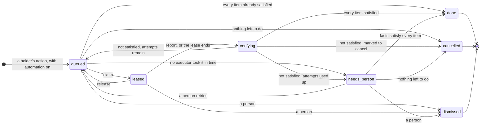

# 6. Tasks

This is Park's most important external interface, and the hardest to change once published.

A **task** is work that a verdict calls for, leased to an executor, and complete only when forge facts confirm it. Executors are programs or people; Park never does the work itself.

## Responsibilities

- Turn changed verdicts into tasks, for members who turned automation on.
- Lease tasks to executors, so that no two work on the same code at once.
- Verify every outcome against forge facts, retry within limits, and hand what cannot be fixed to a person.

## Data

| Record | Holds |
|---|---|
| `task` | Member, unit, state, priority (the highest among the parts behind its items), attempt number, lease (lease ID, the token holding it, the executor's label, expiry), whether it is marked to cancel after this attempt, earliest time for the next attempt, state times |
| `task_item` | Task, pull request, action, targets (thread IDs, review IDs, check names, or reviewer accounts), the facts at the start of the attempt, state (open, satisfied, or dropped) |
| `attempt_budget` | Per member, unit, and action: the attempts used. A new task for the same work continues the count; only a person resets it |
| `task_event` | Every state change, report, heartbeat note, and verification result, with its actor: an executor's token, a member, or Park. Never updated or deleted |
| `automation` | Per member: the actions that may become tasks, optionally limited to some repositories |

## Units and locks

A task works on one **unit** — a group, or a pull request in no group — the same unit whose ball its member holds ([Verdicts](04-verdicts.md#placing-the-ball)). The pull requests of a chain that is in no group are reviewed separately, so each is a unit of its own; a task on one of them still locks the whole chain. A pull request in no group and no chain locks itself.

A group is one piece of work, and two agents editing it at once collide; so do two agents in one chain, where changing one pull request moves the ones stacked on it. Hence:

- **At most one queued task per member per unit.** New work for that member and unit joins it.
- **At most one active task — leased or verifying — per group and per chain**, whichever member it is for. A task **locks** every group and chain its items touch, so a chain that spans two groups occupies both.
- **Locks are rows.** A claim locks every pull request of every group and chain its items touch, with `FOR UPDATE`, in order of ID, and only then checks that no active task holds any of them. Two claims on one group wait for each other, rather than both finding it free.

## Items and post-conditions

A task holds **items**: one action on one pull request, with its targets. Each action declares a **post-condition** over forge facts, and a task is done when every item's post-condition holds. Post-conditions look for what happened after the attempt started, not for a state that may have moved on since: a reviewer who answers again before verification does not undo the member's reply.

| Action | Targets | Post-condition | Settled when |
|---|---|---|---|
| `resolve_conflicts` | — | The forge reports the pull request free of conflicts | Mergeability is known |
| `fix_checks` | The required set: the checks the forge requires for the base branch or, without protection, the checks that ran on the head at the start | The head commit differs from the one at the start, and every check in the required set has run on it and passed | Every check in the set has reported on the new head; one that has not reported yet is pending |
| `address_comments` | The threads and written reviews waiting on the member at the start | The member commented in each target thread after the start, or it is resolved; and commented on the pull request, or pushed, after each target review | At once |
| `request_review` | The reviewers the part names; none, meaning anyone | For each target: a review request was made to them after the start, or they reviewed after the start; and, where the author may dismiss, they no longer request changes. With no targets: someone was asked after the start | At once |
| `review` | — | The member submitted a review after the start | At once |

"The member's" means from one of the member's linked forge accounts: the executor acts on the member's behalf, as the member.

A post-condition that has not settled is not judged. Verification waits for the facts to settle, up to a deadline.

## Lifecycle



| State | Means | Leaves by |
|---|---|---|
| `queued` | Waiting for an executor, a free lock, or the time of its next attempt | A claim (→ leased); facts satisfying every item (→ done); nothing left to do (→ cancelled); no executor of its member taking it in time (→ needs person); a person (→ dismissed) |
| `leased` | An executor holds it | A report, or the lease ending — it expires, its token is revoked, or its member is disabled (→ verifying); a release (→ queued); a person (→ dismissed) |
| `verifying` | Waiting for the facts to confirm it | Every item satisfied (→ done). Otherwise, once settled or at the deadline: marked to cancel (→ cancelled), attempts remaining (→ queued), attempts used up (→ needs person) |
| `done` | The facts confirmed every item | Final |
| `needs_person` | Its attempts are used up, or no executor took it in time | A person retries it (→ queued, attempts reset) or dismisses it; facts satisfying every item (→ done); nothing left to do (→ cancelled) |
| `cancelled` | Nothing is left to do: its pull requests merged or closed, its member no longer holds the ball for any item, or its member was disabled | Final |
| `dismissed` | A person closed it, with a reason | Final |

A task is in exactly one state at a time, and each state has exactly one meaning. Agents will still make mistakes; what changes is that every mistake is detected and shown — "reported done by executor E, but 3 of 27 threads have no answer" — instead of a silent stall.

**Facts never end a lease.** If, while a task is leased, its pull requests merge or close, or its member stops holding the ball, the task is only marked to cancel after this attempt. The attempt ends as usual and is verified: if every item is satisfied, the task is done; otherwise it is cancelled. A review task whose review lands is therefore done, not cancelled.

## Flow: create

Runs when a unit's verdict changes, for each member who holds its ball, and for each of their actions in it.

1. **Qualify.** Continue only if the action can be a task, the rule allows it, and the member's automation covers the action for this repository.
2. **Build the item**: the action on its pull request, with its targets — threads, written reviews, and checks from the facts; reviewers from the part.
3. **Keep only what is new.** If its post-condition holds now, there is nothing to do. If an unfinished task of the member already holds the same action on this pull request, only the targets it does not hold go on — so an executor's own progress, which changes the part's reason, never queues a copy of the work it is doing.
4. **Place it.** If the member has a queued task on the unit, add the item there, merging it with any item for the same pull request and action. Otherwise create a queued task — even if an active task holds the unit: the new one waits for the lock as a follow-up.

When a member stops holding a unit's ball, or no longer has an action, the matching items are dropped from their queued task, and a queued task left with no items is cancelled. Items of leased and verifying tasks stay until the attempt ends. When a pull request moves to another group, its items in queued tasks move to the new unit.

## Flow: claim

1. The executor calls `POST /tasks/claim`, naming the actions it can do and, optionally, the repositories it covers and how long it is willing to wait.
2. Park considers the queued tasks of the member who owns the token that have an item the executor can do, and whose next-attempt time has passed — normal priority before low, oldest first.
3. For each candidate, in one transaction, skipping any that a concurrent claim holds:
   1. **Lock** the rows of every pull request the task's items touch, with their groups and chains (above). If an active task holds any of them, try the next candidate.
   2. **Split by capability.** Items whose action the executor cannot do stay behind in a queued task of their own; the claim takes the rest.
   3. **Check the post-conditions** against current facts, and drop satisfied items and targets. A task left with none is done without running; try the next candidate.
   4. **Record the start**: for each item, the facts its post-condition compares against — head commit, thread and review states, check states, review requests — and the time.
   5. **Lease it**: state `leased`, a new lease ID, a lease expiry, the token, and the executor's label.
4. Return the task — or nothing, after waiting up to the requested time.

The executor receives the task's ID, its lease ID, the attempt number, the lease expiry, and the heartbeat interval, and for each item: the pull request (repository, number, head and base branches, head commit), the action, its targets, why earlier attempts failed verification, and a link to the pull request rendered for this response.

A queued task that its member's executors have left unclaimed for too long — while its lock was free — moves to `needs_person`, so work no executor can do does not wait unseen.

## Flow: work

- The executor sends heartbeats, carrying its lease ID, before the lease expires. Each one extends the lease, and may carry a progress note and a flag saying the executor is waiting on its member; the dashboard shows both.
- The heartbeat's answer says whether the lease is still current, and whether the task is marked to cancel. If the lease is no longer current — it expired, its token was revoked, or a person dismissed the task — the executor must stop.
- **Fencing**: the executor sends a heartbeat before each write to the forge, and stops if the lease is no longer current. Park cannot stop a write it does not know about; this keeps an executor whose lease has lapsed from acting on work that has passed to another.
- An executor that has to pause, for example on a usage limit, either keeps sending heartbeats or releases the task.
- Work that arrives meanwhile goes to a follow-up task. The scope of a leased task does not change.

## Flow: report and verify

1. The executor calls `POST /tasks/{id}/report` with its lease ID, an outcome, `done` or `failed`, and for each item what it did: commits pushed, threads and reviews answered, a note. Reports are idempotent per lease.
2. The task moves to `verifying`, whatever the outcome says: a report is a claim, not a fact.
3. Park refreshes every pull request the task touches at once, and then polls them on a short period until every item has settled, without waiting for webhooks. Only facts fetched after the attempt ended count ([D56](10-design-log.md#d56-verification-counts-only-facts-fetched-after-the-attempt)).
4. When every item is satisfied, the task is `done`.
5. When an item is not satisfied once its facts have settled, or the deadline passes, the attempt fails. Park records why, item by item — "3 of 27 threads have no answer: T4, T9, T12". A task marked to cancel is then `cancelled`. Otherwise the attempt counts against the budget for its member, unit, and action — once for each action that failed ([D57](10-design-log.md#d57-every-failing-action-spends-an-attempt)): with attempts remaining for all of them, the task is queued again after a backoff; with none for any, it moves to `needs_person`. A task that returns to the queue while a follow-up waits there on the same unit takes over the follow-up's items, and the follow-up is cancelled, so there is still one queued task per member per unit.
6. Items whose pull request merged or closed meanwhile are dropped.

The deadline pauses while the facts of the task's pull requests are stale, so a forge outage or a rate limit does not use up attempts. A lease that ends without a report — it expired, its token was revoked, or its member was disabled — is verified in the same way, as if the executor had reported: it may have finished the work and died before reporting.

## Flow: a person takes over

The dashboard lists tasks that need a person, with every attempt's verification failures. A person can retry the task, which queues it again with the attempt budget reset, or dismiss it with a reason ([D58](10-design-log.md#d58-dismissing-a-task-closes-it-not-its-work)). A person can also dismiss a queued or leased task at any time. A task waiting for a person also leaves on its own: it is done when the facts satisfy every item — someone fixed it by hand — and cancelled when its pull requests merge or close, or its member is disabled.

## The API

| Endpoint | Does |
|---|---|
| `POST /tasks/claim` | Claim the next task this executor may take; returns it with a lease, or nothing |
| `POST /tasks/{id}/heartbeat` | Extend the lease, optionally with a progress note |
| `POST /tasks/{id}/report` | Report the outcome of this attempt; moves the task to verifying |
| `POST /tasks/{id}/release` | Give the task back without a result; the attempt is not counted |

Executors authenticate with API tokens scoped to `tasks:work` ([Identity](07-identity.md)), and every lease is recorded against the token that holds it. Every call after the claim carries the lease ID; a call whose lease is no longer current is refused, with the task's current state. A claim retried with the same `Idempotency-Key`, from the same token, returns the same lease instead of a second task.

A claim:

```
POST /api/v1/tasks/claim
{
  "executor": "laptop",
  "actions": ["address_comments", "fix_checks", "resolve_conflicts"],
  "wait_seconds": 30
}

200 OK
{
  "id": "tsk_8f2c",
  "lease_id": "lse_51b0",
  "attempt": 2,
  "lease_expires_at": "2026-09-28T10:15:00Z",
  "heartbeat_seconds": 300,
  "items": [
    {
      "id": "itm_41",
      "pull_request": {
        "repo": "acme/api", "number": 12,
        "head": "feat/schedule", "base": "main", "head_commit": "9b1e0c4"
      },
      "action": "address_comments",
      "targets": { "threads": ["T3"], "reviews": [] },
      "previous_failures": ["T3: no answer"],
      "link": "https://forge.example.com/acme/api/pull/12"
    }
  ]
}
```

A report:

```
POST /api/v1/tasks/tsk_8f2c/report
{
  "lease_id": "lse_51b0",
  "outcome": "done",
  "items": [
    { "id": "itm_41", "commits": ["c07d2aa"], "threads": ["T3"], "note": "Renamed the option and answered the thread." }
  ]
}
```

## Rules

- **T1. Facts decide.** A task is done only when forge facts satisfy every item's post-condition. A report moves a task to verifying, never to done.
- **T2. One state at a time**, and every change is recorded with its actor and reason.
- **T3. One queued task per member per unit.** New work joins it.
- **T4. One active task per group and per chain**, across members. A task locks every group and chain its items touch, by locking their pull requests' rows in order of ID.
- **T5. Checked before dispatch.** Items and targets already satisfied are dropped when a task is claimed, and a task left with none is done without running — so dispatching again after a lost lease is safe.
- **T6. A leased task's scope is fixed.** Work that arrives meanwhile goes to a follow-up.
- **T7. Facts never end a lease.** A lease ends by a report, a release, or its end — expiry, a revoked token, a disabled member — or by a person dismissing the task. Facts can only mark a task to cancel after the attempt, which is then verified like any other. The executor may still be finishing: it has answered every thread but not yet pushed the change it promised, and ending the lease early would let another task start on the same code.
- **T8. A lease that ends without a report is verified like a report.**
- **T9. Attempts are bounded per member, unit, and action.** A new task for the same work continues the count; only a person resets it. Every failed verification records its reasons, item by item, and the next attempt receives them.
- **T10. Executors see and claim only their own member's tasks**, and take only the items whose actions they name; the other items stay queued.
- **T11. Tasks never feed verdicts** ([V7](04-verdicts.md#rules)).
- **T12. Park does not care how a task is done**, and no action merges or closes a pull request.
- **T13. Every call carries its lease.** A heartbeat or report whose lease is no longer current is refused, and executors send a heartbeat before each write to the forge.
- **T14. Post-conditions look for events after the start**, so a later change by someone else neither fakes nor undoes the member's work.

## Defaults

These are starting points; see [Open questions](11-open-questions.md).

| Setting | Default |
|---|---|
| Lease | 15 minutes, extended by each heartbeat |
| Heartbeat | Every 5 minutes, and before each write to the forge |
| Attempts | 3 per member, unit, and action |
| Backoff before another attempt | 10 minutes, doubling |
| Polling while verifying | Every 30 seconds |
| Verification deadline | 60 minutes for `fix_checks`; 10 minutes for the rest; paused while facts are stale |
| Queued without a claim | 24 hours, then it needs a person |
| Longest claim wait | 30 seconds |

## Costs

Park tracks leases, expires them, and deals with lost executors, and every action needs a post-condition that can be checked from forge facts. This is the price of never losing track of a task, and it is paid once, in Park, rather than in every executor.
